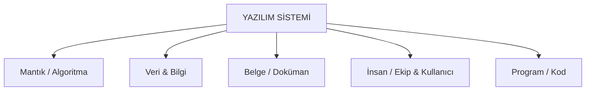
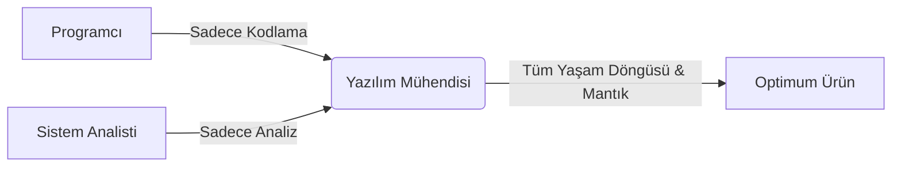
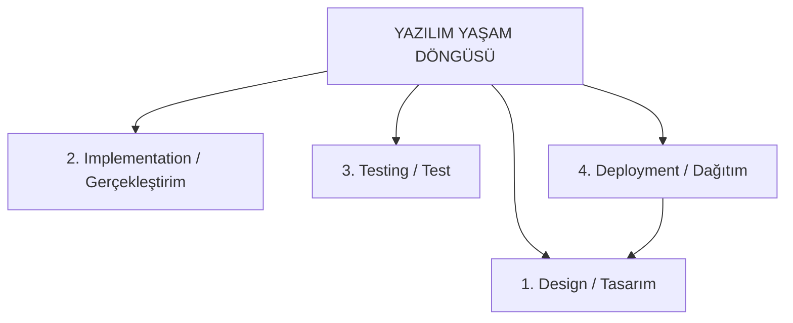

---

## İçindekiler

1. [Yazılım Nedir?](#1--yazılım-nedir)
2. [Yazılım ve Donanım Karşılaştırması](#2--yazılım-ve-donanım-karşılaştırması)
3. [Yazılım Üretim Ortamı ve Zorluklar](#3--yazılım-üretim-ortamı-ve-zorluklar)
4. [Yazılım Mühendisliği ve Rol Dağılımları](#4--yazılım-mühendisliği-ve-rol-dağılımları)
5. [Yazılımların Sınanması ve Hata Analizi](#5--yazılımların-sınanması-ve-hata-analizi)
6. [Yazılım Maliyetleri](#6--yazılım-maliyetleri)
7. [Yazılım Sistemlerinin Sınıflandırılması](#7--yazılım-sistemlerinin-sınıflandırılması)
8. [Yazılımda Kalite](#8--yazılımda-kalite)
9. [Özet ve Bölüm Değerlendirme Soruları](#9--özet-ve-bölüm-değerlendirme-soruları)
10. [Araştırma Ödevleri](#10--araştırma-ödevleri)

---

## 1. YAZILIM NEDİR?

### 1.1. Yazılımın Temel Yapı Taşları

Yazılım; **Mantık**, **Veri/Bilgi**, **Belge**, **İnsan** ve **Program** bileşenlerinin belirli bir üretim amacına yönelik olarak bir araya getirilmesi ve yönetilmesi için kullanılan yöntem, araç, bilgi ve belgelerin bütünüdür.

> **Genel Tanım:**
> Yazılım en yalın biçimiyle, *"Bir sistemin donanım bileşenleri dışında kalan her şey"* olarak ifade edilir.

---

### 1.2. Bileşen Detayları

#### 1. Mantık (Algoritma)
* Bilginin yapısını inceler; kesin sonuca ulaşmak için **doğru** ile **yanlış** arasında akıl yürütme ayrımı yapar.
* Bilgisayarlaştırılmak istenen işin mevcut mantığı yazılıma yansıtılmak zorundadır.
* Yazılımın en kritik ve temel bileşenidir.

#### 2. Veri (Data) ve Bilgi (Information)
* **Veri:** İşlenmemiş ham bilgidir.
* **Bilgi:** Verinin anlamlandırılarak işlenmiş halidir.
* Her yazılım mutlaka bir veri üzerinde çalışır. Veri dış ortamdan alınabileceği gibi yazılım içinde de üretilebilir.

> **Temel Amaç:**
> 
> $$\text{Veri (Ham)} \xrightarrow{\quad \text{İşleme ve Mantık} \quad} \text{Bilgi (Anlamlı)}$$

#### 3. Belge (Dokümanlar)
* Yazılım üretimi bir mühendislik disiplinidir.
* Planlama, analiz, tasarım, gerçekleştirim ve test aşamalarındaki tüm ara ürünler **düzenli bir şekilde belgelenmelidir.**

#### 4. İnsan (Geliştirici ve Kullanıcı)
* **İki Boyutludur:** Yazılımı geliştiren teknik ekip ve nihai kullanıcılar.
* Günümüzde yazılım geliştirme bireysel bir iş olmaktan çıkmış, **takım çalışması** haline gelmiştir.

#### 5. Program (Kod)
* Yazılım sürecinin somut ana çıktısıdır.
* Program işletime alındıktan sonra **bakım çalışmaları** sürekli devam eder.

> **Neden Sürekli Bakım Gereklidir?**
> 1. Hiçbir program tüm olasılıklar göz önüne alınarak bütünüyle test edilemez.
> 2. İşletmeler dinamiktir; zamanla yeni istek ve gereksinimler ortaya çıkar.

---

## 2. YAZILIM VE DONANIM KARŞILAŞTIRMASI

Yazılım ile donanım doğaları gereği birbirinden tamamen farklı dinamiklere sahiptir:

| Karşılaştırılan Özellik | Yazılım (Software) | Donanım (Hardware) |
| :--- | :--- | :--- |
| **Üretim Mantığı** | Mühendislik yöntemleriyle **geliştirilir**. | Fabrikalarda **seri olarak üretilir**. |
| **Yeniden Kullanım** | Parça temini düşüktür *(Yeniden kullanılabilirlik %1-2)*. | Standart donanım parçaları dışarıdan kolayca temin edilir. |
| **Aşınma / Eskime** | Fiziksel olarak **eskimez ve aşınmaz**. | Belirli bir çalışma ömrü vardır, zamanla **aşınır ve bozulur**. |
| **Eskime Anlamı** | Teknolojinin gerisinde kalması ve yeni gereksinimleri karşılayamamasıdır. | Fiziksel parçaların ömrünü tamamlamasıdır. |
| **Yedekleme & Hata Toleransı** | Aynısını kopyalamak hatayı çözmez *(Farklı yazılmış eş yazılım gerekir)*. | Hayati parçanın yedeği eklenerek yedekli çalıştırılabilir. |
| **Gelişim / Güncelleme** | Kod geliştirmeleri ve güncellemeler ile sisteme ek yapılır. | Arızalanan veya eskiyen parça fiziksel olarak yenisiyle değiştirilir. |

---

### Kritik Sistemlerde Yazılımın Hayati Önemi

* **2000 Yılı Diyaliz Makineleri Krizi:** Yazılım uyumsuzluğu nedeniyle diyaliz cihazları çalışmamış ve böbrek hastaları hayati riskle karşılaşmıştır.
* **Japonya Telekomünikasyon Hatası:** Telefon yazılımındaki tek bir hata nedeniyle 10.000'lerce abone saatlerce iletişim kuramamıştır.
* **Uçak Aviyonik Sistemleri (Kritik Sistemler):** Hata toleransı sağlamak adına aynı işi yapan birden fazla bağımsız eş yazılım (redundancy) bir arada kullanılır.

---

## 3. YAZILIM ÜRETİM ORTAMI VE ZORLUKLAR

Yazılım üretimi karmaşık ve çok değişkenli bir ortamda gerçekleşir:

* **İnsan ve İletişim Zorlukları:**
  * Değişik yetenekte çok sayıda personel (analist, programcı, test uzmanı vb.).
  * Yeniliğe tepki gösteren kullanıcılar ve yöneticiler.
  * Yüksek personel değişim oranı.
* **Gereksinim ve Standart Eksiklikleri:**
  * Yetersiz veya muğlak tanımlanmış kullanıcı beklentileri.
  * Standart ve yöntem eksiklikleri.
  * Mevcut yazılımlardaki kalitesizlik.
* ⏳ **Kısıtlar ve Maliyet:**
  * Zaman, maliyet ve işgücü kısıtları.
  * Yüksek eğitim maliyetleri.
  * Verimsiz kaynak kullanımı.

---

## 4. YAZILIM MÜHENDİSLİĞİ VE ROL DAĞILIMLARI

### 4.1. IEEE Tanımı (1993)

> **IEEE Tanımı:**
> *"Yazılım Mühendisliği: Sistemli, düzenli, ölçülebilir bir yaklaşımın yazılım geliştirmede, yazılımın işlenilmesinde ve bakımında uygulanmasıdır. Diğer bir deyişle mühendisliğin yazılıma uygulanmasıdır."*

* **Hedef:** Yazılım üretimindeki karmaşıklıkları gidermek, süreci standartlaştırmaktır.
* Geçmişteki basit iş akış şemaları günümüz karmaşık projelerinde yetersiz kalmaktadır.

---

### 4.2. Rollerin Karşılaştırılması

* **Programcı:** Kod yazımına odaklanır. Yazılım mühendisi programcının tüm yeteneklerine sahiptir ancak odağı sistemin mantıksal boyutudur.
* **Sistem Analisti:** Sadece sistemin **analiz** aşamasıyla ilgilenir.
* **Yazılım Mühendisi:** Analizden bakıma kadar **tüm aşamaların içindedir.** Temel hedefi, üretimin **en az maliyet** ve **en yüksek nitelikte** yapılmasını sağlamaktır.

---

## 5. YAZILIMLARIN SINANMASI VE HATA ANALİZİ

### 5.1. Sınanabilirlik Durumu

Bir programı tüm olasılıklarıyla test etmek **teorik olarak mümkün olsa da uygulamada imkânsızdır.** Bu nedenle yazılımlar ancak **sınırlı sayıda veri** ile sınanabilir.

---

### 5.2. Hataların Aşamala Göre Dağılımı ve Yayılma Maliyeti

Yazılım üretimindeki hatalar **yayılma özelliği** gösterir. Hata ne kadar geç fark edilirse, düzeltme maliyeti katlanarak artar.

| Aşamalar | Hata Dağılım Oranı (%) | Hata Düzeltme Maliyet Katsayısı |
| :--- | :---: | :---: |
| **Analiz** | - | $1\times$ |
| **Mantıksal Tasarım** | $\%20$ | $5\times$ |
| **İşlevsel Tasarım** | $\%15$ | $5\times$ |
| **Kodlama** | $\%30$ | $10\times$ |
| **Test** | - | $25\times$ |
| **Kabul Testi** | - | $50\times$ |
| **İşletim (Canlı Ortam)** | - | $100\times$ |

---

### 5.3. Hata Türleri ve Etkileri Analizi (FMEA)

Hataların risk derecesini belirlemek için **Risk Öncelik Derecesi (RPN)** kullanılır:

$$\text{Risk Öncelik Derecesi} = \text{SEV} \times \text{OCCUR} \times \text{DETEC}$$

* **SEV (Severity):** Hatanın şiddet derecesi.
* **OCCUR (Occurrence):** Hatanın ortaya çıkma olasılığı.
* **DETEC (Detection):** Hatanın fark edilme/yakalanma derecesi.

---

## 6. YAZILIM MALİYETLERİ

Günümüzde yazılım maliyetleri donanım maliyetlerine kıyasla çok hızlı yükselmektedir.

> *"Yazılımımızı alırsanız yanında donanımı ücretsiz sağlayacağız"* söylemi günümüzde gerçeklik kazanmıştır.

### Maliyet Karşılaştırması

* **Kurumsal ERP Yazılımı:** $\sim\$100.000\text{ USD}$ *(Tek bir kopyası)*
* **Kişisel Bilgisayar (Donanım):** $<\$1.000\text{ USD}$

Donanım kopyalamak fiziksel maliyet getirirken, yazılımın kopyalama maliyeti sıfıra yakındır. Ancak yazılımın **geliştirme ve bakım maliyeti** son derece yüksektir.

---

## 7. YAZILIM SİSTEMLERİNİN SINIFLANDIRILMASI

### 7.1. İşlevlerine Göre Sınıflandırma

* **Hesaplama:** Mühendislik çözümleme yazılımları.
* **Veri İşleme:** Bankacılık ve finans sistemleri.
* **Süreç Temelli:** Gömülü sistemler (Embedded systems).
* **Kural Temelli:** Robotik, Yapay Zekâ sistemleri.
* **CAD:** Bilgisayar destekli tasarım sistemleri.
* **Sinyal İşleme:** İletişim ve radar sistemleri.

---

### 7.2. Zamana Dayalı Özelliklerine Göre Sınıflandırma

* **Toplu (Çevrim-Dışı / Batch):** Verilerin biriktirilip sonradan topluca işlendiği sistemler.
* **Çevrim-İçi (Online):** Anlık erişim sağlayan sistemler.
* ⏱**Gerçek Zamanlı (Real-Time):** Tepki süresi kritik olan ve anında yanıt vermesi gereken sistemler.

---

### 7.3. Boyutlarına Göre Sınıflandırma *(SS: Satır Sayısı - LOC)*

| Boyut Kategorisi | Kod Satır Sayısı (SS) | Örnek Yazılım Türleri |
| :--- | :--- | :--- |
| **Küçük** | $SS < 2.000$ | PC Oyunları, Öğrenci Projeleri |
| **Orta** | $2.000 < SS < 100.000$ | CAD Yazılımları, BDE Yazılımları |
| **Büyük** | $100.000 < SS < 1.000.000$ | İşletim Sistemleri |
| **Çok Büyük** | $SS > 1.000.000$ | Komuta Kontrol, Hava Tahmini, Yıldız Savaşları Sistemleri |

---

## 8. YAZILIMDA KALİTE

### 8.1. Kalite Assurance (Kalite Güvence)

Yazılımda kalite; üretim süreci boyunca ara ürünlere ilişkin **kalite standartlarının geliştirilmesi** ve geliştirme işlemlerinin bu standartlara **uygunluğunun denetlenmesidir.**

> **Kalite Sağlama Etkinliklerinin Faydaları:**
> * Yazılım maliyetlerini düşürür.
> * Yazılım üretiminin yönetimini kolaylaştırır.
> * Belgeleme ve standart sorunlarını ortadan kaldırır.

---

### 8.2. Kaliteli ve Kalitesiz Proje Karşılaştırması

| Proje Tipi | İş Gücü (Programcı $\times$ Ay) | Toplam Masraf |
| :--- | :---: | :---: |
| **Kalite Sistemsiz Proje** | $15$ | $65.000\ \text{£}$ |
| **Kalite Sistemli Proje** | $6$ | $50.000\ \text{£}$ |

---

### 8.3. Yazılım Kalite Kriterleri *(20 Temel Faktör)*

| Faktör | Faktör | Faktör | Faktör |
| :--- | :--- | :--- | :--- |
| **Ekonomi** | **Tamlık** | **Yeniden Kullanılabilirlik** | **Etkinlik** |
| **Bütünlük** | **Güvenirlik** | **Modülerlik** | **Belgeleme** |
| **Kullanılabilirlik** | **Temizlik** | **Değiştirilebilirlik** | **Geçerlik** |
| **Esneklik** | **Genellik** | **Sınanabilirlik** | **Taşınabilirlik** |
| **Bakılabilirlik** | **Anlaşılabilirlik** | **Birlikte Çalışabilirlik** | |

---

## 9. ÖZET VE BÖLÜM DEĞERLENDİRME SORULARI

### Özet
1. **Yazılım:** Mantık, veri, belge, insan ve program bileşenlerinin bütünsel ve disiplinli yönetimidir.
2. **Yazılım Mühendisliği:** Karmaşıklığı yönetmek, maliyeti düşürmek ve kaliteyi artırmak için mühendislik ilkelerinin yazılıma uygulanmasıdır.
3. **Kalite Kontrol:** Hataların yayılma maliyetini engeller, kaynak kullanımını optimize eder.

---

### Bölüm Değerlendirme Soruları

1. Yazılım ile program arasındaki temel fark nedir?
2. Yazılım ile donanım arasındaki belirgin farklılıkları karşılaştırınız.
3. Donanım ucuzlarken yazılım maliyetlerinin yükselmesinin nedenleri nelerdir?
4. Yazılım mühendisliğini diğer geleneksel mühendislik disiplinlerinden ayıran yönler nelerdir?
5. Yazılım sınıflandırmasını dikkate alarak her sınıf için bir örnek veriniz.
6. Yazılım mühendisi ile programcı arasındaki temel rol farkları nelerdir?
7. Yazılım hatalarında **"Yayılma Özelliği"** ne anlama gelmektedir?
8. Yazılım maliyetlerinde hangi sınıflandırma türü ağır basmaktadır?
9. İşlevlerine göre sınıflandırmada **"Kural Temelli"** sistemlere bir örnek veriniz.
10. Yazılım kalitesini tanımlayınız ve temel faydalarını açıklayınız.

---

## 10. ARAŞTIRMA ÖDEVLERİ

### Ödev Konuları
1. **Yazılım Yaşam Döngüsü (SDLC):** Aşama ve detaylarını araştırınız.
2. **Yazılım Süreç Modelleri:** Şelale (Waterfall), Çevik (Agile), Spiral vb. süreç modellerini inceleyiniz.

