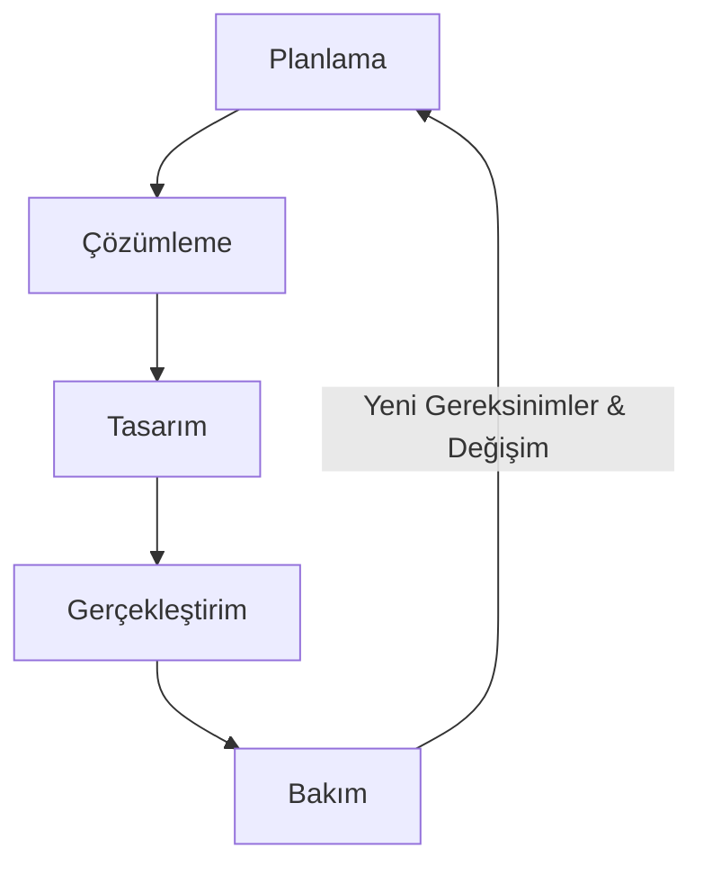
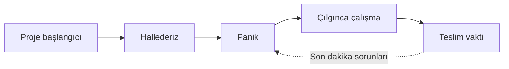
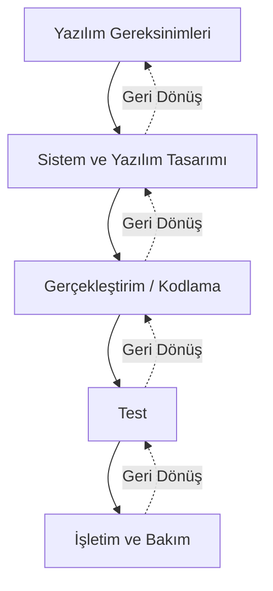
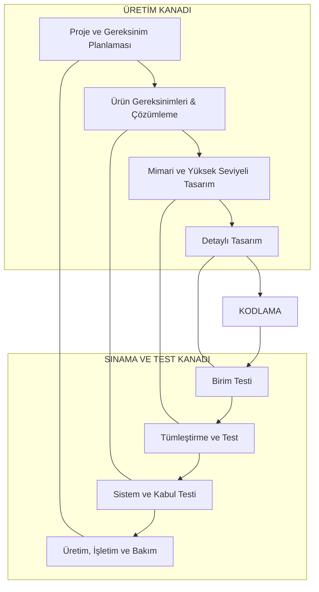
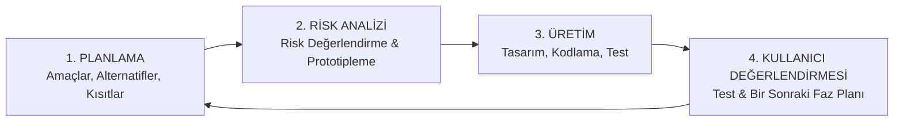
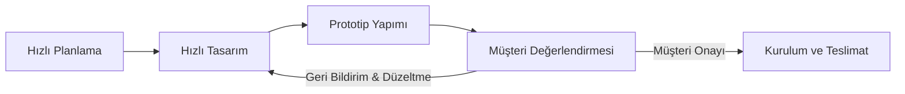
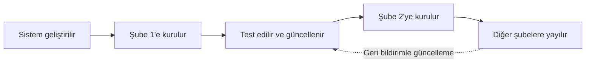
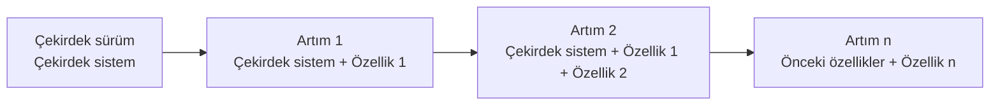

## İçindekiler

1. [Giriş ve Hedefler](#1--giriş-ve-hedefler)
2. [Yazılım Yaşam Döngüsü (Software Life Cycle)](#2--yazılım-yaşam-döngüsü-software-life-cycle)
3. [Belirtim Yöntemleri (Specification Methods)](#3--belirtim-yöntemleri-specification-methods)
4. [Yazılım Süreç Modelleri (Process Models)](#4--yazılım-süreç-modelleri-process-models)
   - [4.1. Gelişigüzel Model](#41-gelişigüzel-model)
   - [4.2. Barok Modeli](#42-barok-modeli)
   - [4.3. Çağlayan (Şelale / Waterfall) Modeli](#43-çağlayan-şelale--waterfall-modeli)
   - [4.4. V Süreç Modeli](#44-v-süreç-modeli)
   - [4.5. Helezonik (Spiral) Model](#45-helezonik-spiral-model)
   - [4.6. Prototipleme Modeli](#46-prototipleme-modeli)
   - [4.7. Evrimsel Geliştirme Süreç Modeli](#47-evrimsel-geliştirme-süreç-modeli)
   - [4.8. Artırımsal Geliştirme Süreç Modeli](#48-artırımsal-geliştirme-süreç-modeli)
   - [4.9. Araştırma Tabanlı Model (Yap-At)](#49-araştırma-tabanlı-model-yap-at)
5. [Yazılım Metodolojileri ve Standartları](#5--yazılım-metodolojileri-ve-standartları)
6. [Yapısal Sistem Tasarım Metodolojisi](#6--yapısal-sistem-tasarım-metodolojisi)
7. [Özet: Süreç Modelleri ve Örnek Proje Eşleşme Tablosu](#7--özet-süreç-modelleri-ve-örnek-proje-eşleşme-tablosu)

---

## 1. GİRİŞ VE HEDEFLER

Bu bölümün temel amacı; yazılım geliştirme yaşam döngüsünün (*Software Life Cycle*) çekirdek aşamalarını detaylandırmak, uygulamada kullanılan yazılım süreç modellerini incelemek ve **Metodoloji** kavramını açıklamaktır.

### Çekirdek Aşamalar
* **Planlama**
* **Çözümleme (Analiz)**
* **Tasarım**
* **Gerçekleştirim (Kodlama & Test)**
* **Bakım**

---

## 2. YAZILIM YAŞAM DÖNGÜSÜ (SOFTWARE LIFE CYCLE)

### 2.1. Tanımı ve Doğası
Yazılım yaşam döngüsü; herhangi bir yazılımın **üretim aşaması** ile **kullanım (işletim) aşaması** boyunca geçirdiği tüm süreçlerin bütünüdür.

* **Döngüsel Yapı:** Yazılım gereksinimleri sürekli değiştiği ve genişlediği için bu süreç doğrusal değil, döngüseldir.
* **Geri Dönüşler:** Herhangi bir aşamadan önceki bir aşamaya dönmek ve geliştirme yapıp tekrar ilerlemek mümkündür.

### 2.2. Yazılım Yaşam Döngüsü Ne Sağlar?
1. Mühendislik ilkelerinin (üretim, işletme ve bakım) yazılıma uyarlanmasını sağlar.
2. Süreci yönetilebilir **fazlara (aşamalara)** bölerek proje yönetimini kolaylaştırır.
3. Her aşamada nelerin yapılacağını ve hangi çıktılar/standartların üretileceğini netleştirir.
4. **Kaliteli yazılım geliştirilmesine** zemin hazırlar.

> **Süreç Yönetimi Olmazsa (Yaratıcı Süreç Çöküşü):**
> 
Disiplinsiz projelerde süreç genelde aşağıdaki kriz döngüsüne dönüşür:

### 2.3. Yaşam Döngüsünün Çekirdek Adımları

| Aşama | İçerik ve Amacı | Temel Çıktılar / Özellikler |
| :--- | :--- | :--- |
| **Planlama** | Fizibilite (olurluk/yapılabilirlik) çalışması yapılır. Personel, donanım, bütçe gereksinimleri belirlenir. | Proje Planı, Fizibilite Raporu |
| **Çözümleme (Analiz)** | Sistem gereksinimleri ve işlevleri ayrıntılandırılır. Var olan işleyiş incelenir, temel sorunlar tespit edilir. | Sistem Analiz Raporu, Gereksinim Belirtimi |
| **Tasarım** | Belirlenen gereksinimlere yanıt verecek sistem yapısı oluşturulur. • **Mantıksal Tasarım:** Önerilen sistem yapısı, örgütsel değişiklikler. • **Fiziksel Tasarım:** Yazılım bileşenleri ve detayları. | Sistem Tasarım Raporu, Mimari Tasarım |
| **Gerçekleştirim** | Kodlama, test etme (birim, tümleştirme, sistem) ve kurulum çalışmaları yürütülür. | Çalışan Yazılım, Test Raporları |
| **Bakım** | Teslimden sonra ortaya çıkan hataların giderilmesi ve yeni işlevselliklerin eklenmesi sürecidir. | Güncellemeler, Yama (Patch) Sürümleri |

---

## 3. BELİRTİM YÖNTEMLERİ (SPECIFICATION METHODS)

Çekirdek süreçleri gerçekleştirmek ve aşamalar arasındaki ilişkiyi tanımlamak için kullanılan yöntemlerdir:

| Kategori | Açıklama | Kullanılan Yöntemler |
| :--- | :--- | :--- |
| **Süreç Akışı Yöntemleri** | Süreçler arası ilişkileri ve veri iletişimini gösterir. | Veri Akış Şemaları (DFD), Yapısal Şemalar, Nesne/Sınıf Diyagramları |
| **Süreç Tanımlama Yöntemleri** | Süreçlerin iç işleyiş mantığını gösterir. | Düz Metin, Algoritmalar, Karar Tabloları, Karar Ağaçları, Anlatım Dili (Pseudocode) |
| **Veri Tanımlama Yöntemleri** | Süreçler tarafından kullanılan verilerin yapısını tanımlar. | Nesne-İlişki Modeli (ERD), Veritabanı Tabloları, Veri Sözlüğü (Data Dictionary) |

---

## 4. YAZILIM SÜREÇ MODELLERİ (PROCESS MODELS)

Süreç modelleri; yazılım üretme işinin genel yapılma düzenine ilişkin rehberlerdir. Süreçlerin hangi sırada ve nasıl uygulanacağını tanımlarlar.

### 4.1. Gelişigüzel Model
* **Dönem:** 1960'lı yıllarda kullanılan ilkel yaklaşımdır.
* **Yapı:** Herhangi bir yöntem veya model yoktur.
* **Özellikler:** Geliştiren kişiye tam bağımlıdır. Bir süre sonra geliştiren kişi bile sistemi anlayamaz hale gelir.
* **Kullanım:** Tek kişilik üretim ortamları ve çok basit programlama işleri.
* **Dezavantajı:** İzlenebilirliği ve bakımı son derece zordur.

### 4.2. Barok Modeli
* **Dönem:** 1970'li yıllarda ortaya çıkmıştır.
* **Yapı:** Yaşam döngüsü adımları doğrusal şekilde ilerler.
* **Özellikler:** Gerçekleştirim (kodlama) aşamasına aşırı ağırlık verir.
* **Kritik Hata:** **Belgelemeyi ayrı bir süreç** olarak görür ve kodlama/testten sonra yapılmasını öngörür. (Günümüzde belgeleme, yapılan işin doğal bir parçasıdır).
* **Dezavantajı:** Aşamalar arası geri dönüşler tanımlanmamıştır. Günümüzde kullanımı **önerilmemektedir.**

---

### 4.3. Çağlayan (Şelale / Waterfall) Modeli
Geleneksel model olarak bilinen bu yaklaşımda adımlar sırayla izlenir.

* **Özellikler:** 
  * Barok modelin aksine belgeleme üretimin doğal parçasıdır.
  * Bir önceki ve bir sonraki adıma geri dönüşler tanımlanmıştır.
  * Gereksinimlerin çok net olduğu ve kısa sürecek projeler için uygundur.

#### Avantajları & Dezavantajları

| Avantajları | Dezavantajları / Sorunları |
| :--- | :--- |
| Müşteriler ve ekip tarafından anlaşılması kolaydır. | Gerçek hayattaki projeler nadiren katı doğrusal ilerler. |
| Yönetilebilir birimlere ve aşamalara bölünmüştür. | Ürünün kullanıcıya ulaşma süresi çok uzundur. |
| İş dağılımı ve takibi proje yöneticisi için kolaydır. | Hataların geç fark edilme maliyeti çok yüksektir. |
| Bütçe ve zaman kısıtından ziyade kalitenin ön planda olduğu net projelerde iyi çalışır. | Ekip, iş yükünün %80'ini oluşturan analiz/tasarım aşamasında kod yazamadığı için motivasyon kaybı yaşayabilir. |

---

### 4.4. V Süreç Modeli

Sol kanadı **üretim**, sağ kanadı ise **sınama (test)** faaliyetlerini temsil eden "V" şeklinde bir yapılanmadır.

#### Modeli Oluşturan 3 Ana Yapı
1. **Kullanıcı Modeli:** Geliştirme sürecinin kullanıcı ile olan ilişkilerini ve kabul testlerinin sınırlarını belirler.
2. **Mimari Model:** Sistem tasarımı ve alt sistemlerin sınama planlarını içerir.
3. **Gerçekleştirim Modeli:** Yazılım modüllerinin kodlanması ve birim testlerini kapsar.

> **İhale Kolaylığı:** V Modeli, BT projelerinin **iki aşamalı ihale edilmesi** için çok uygundur (1. İhalede kullanıcı modeli ve iş analizi; 2. İhalede tasarım ve gerçekleştirim).

---

### 4.5. Helezonik (Spiral) Model
Risk analizini merkeze alan, yinelemeli (iterative) ve artırımlı bir modeldir. 4 ana çeyrekten (kadrandan) oluşur:

#### Temel Özellikleri ve Avantajları
* **Risk Analizi Ön Plandadır:** Her döngü öncesinde riskler değerlendirilir.
* **Erken Kullanıcı Katkısı:** Her döngü sonunda çalışan bir ara ürün (prototip) çıktığı için kullanıcı sürece erken dahil olur.
* **Kolay İzleme:** Yöneticiler çalışan ara ürünleri gördüğü için hak ediş ve ilerleme takibi kolaylaşır.

---

### 4.6. Prototipleme Modeli
Gereksinimlerin net olmadığı durumlarda hızlı bir prototip geliştirilerek müşterinin onayına sunulması esasına dayanır.

| Avantajları | Dezavantajları |
| :--- | :--- |
| Müşteri gereksinimlerini somut olarak görür. | "Hızlı ve kirli" (quick and dirty) kodlama alışkanlığı yaratabilir. |
| Karmaşa ve yanlış anlaşılmaları önler. | Düzeltme aşaması atlanırsa performans düşüklüğü oluşur. |
| Beklenmeyen gereksinimler erken netleşir. | Müşteri, prototipi nihai tamamlanmış ürün sanabilir. |

---

### 4.7. Evrimsel Geliştirme Süreç Modeli
İlk tam ölçekli modeldir. Coğrafi olarak geniş alana yayılmış, çok birimli organizasyonlar (örn: **Banka Şubeleri**) için idealdir.

* **Çalışma Mantığı:**

* **Türleri:**
  1. **Keşifçi Geliştirme (*Exploratory*):** Müşteriyle birlikte çalışarak ne istendiğini keşfedip nihai sistemi teslim etmek.
  2. **Atılacak Prototipleme (*Throw-away*):** Gereksinimleri tam anlamak için geçici prototip yapıp sonradan atmak.
* **En Büyük Aksaklıkları:** Konfigürasyon yönetimi, sürüm yönetimi ve değişiklik kontrolünün son derece zor olmasıdır.

---

### 4.8. Artırımsal Geliştirme Süreç Modeli
Sistemin tamamı tek seferde değil, **çekirdek bir işlev** etrafında adım adım yeni özellikler eklenerek geliştirilir.

* **Örnek:** Üniversite bitirme projeleri, işletim sistemi güncellemeleri veya ürün sürümleri (örn: Mobil telefonların $2\text{G} \rightarrow 3\text{G} \rightarrow 4\text{S} \rightarrow 5$ şeklinde aşamalı sunulması).
* Bir taraftan ürünün mevcut hali kullanılırken diğer taraftan sonraki artımın üretimi yapılır.

---

### 4.9. Araştırma Tabanlı Model (Yap-At)
* **Yapısı:** Bütünüyle belirsizlik üzerine kurulu araştırma ortamlarında uygulanır.
* **Kullanım:** Geliştirilen yazılım sınırlı sayıda çalıştırılır, elde edilen akademik/teknik veri alındıktan sonra **yazılım atılır.**
* **Ekonomik Durum:** Zaman ve maliyet kestirimi yapılamadığı için **sabit fiyatlı sözleşmelerde kesinlikle uygulanamaz.**
* **Örnekler:** 
  * En hızlı çalışan asal sayı test programı.
  * En büyük asal sayıyı bulma yazılımı.
  * Deneysel satranç algoritmaları.

---

## 5. YAZILIM METODOLOJİLERİ VE STANDARTLARI

> **Metodoloji Tanımı:**
> Bir BT projesinin veya yazılım yaşam döngüsünün tüm aşamaları boyunca kullanılacak **birbiriyle uyumlu yöntemler bütünüdür.**
> 
> $$
> \text{Metodoloji} = \text{Süreç Modeli} + \text{Belirtim Yöntemleri}
> $$

### Bir Metodolojide Bulunması Gereken Temel Bileşenler
* Ayrıntılandırılmış süreç modeli ve tanımları.
* Girdi ve çıktı tanımları, süreçler arası arayüzler.
* **Yönetim Modelleri:** Proje, Kalite, Risk, Maliyet, Değişiklik ve Konfigürasyon yönetimi modelleri.
* Kullanıcı arayüz standartları.

> **Metodoloji Geliştirme Maliyeti:**
> Bir kuruluşun sıfırdan kendi metodolojisini oluşturması yaklaşık **50 adam/ay'lık** bir iş gücü ve yüksek uzmanlık gerektirir.

---

## 6. YAPISAL SİSTEM TASARIM METODOLOJİSİ

Çağlayan (Şelale) modelini temel alan, geniş bir CASE (Computer-Aided Software Engineering) araç desteğine sahip yaygın bir metodolojidir.

| Aşama | Kullanılan Yöntem ve Araçlar | Amaç ve Kullanım | Çıktı |
| :--- | :--- | :--- | :--- |
| **Planlama** | Veri Akış Şemaları (DFD), Süreç Belirtimleri, Görüşmeler, Maliyet Kestirim Araçları | Süreç İnceleme, Kaynak Kestirimi, Proje Yönetimi | Proje Planı |
| **Analiz** | DFD, Süreç Belirtimleri, Görüşmeler, ERD (Nesne-İlişki Diyagramı), Veri Sözlüğü | Süreç ve Veri Analizi | Sistem Analiz Raporu |
| **Analizden Tasarıma Geçiş** | Akışa dayalı analiz, süreç belirtimlerinin tasarım diline çevrilmesi, ERD'nin tabloya dönüşümü | Başlangıç Tasarımı, Veri Tasarımı | Başlangıç Tasarım Raporu |
| **Tasarım** | Yapısal Şemalar (Structure Charts), Program Tasarım Dili (PDL), Veritabanı Tabloları | Genel Tasarım, Detaylı Tasarım, Veri Tasarımı | Sistem Tasarım Raporu |

---

## 7. ÖZET: SÜREÇ MODELLERİ VE ÖRNEK PROJE EŞLEŞME TABLOSU

| Süreç Modeli | Uyumlu Olduğu Örnek Proje Türü |
| :--- | :--- |
| **1. Gelişigüzel Model** | Öğrenci ders projeleri, tek kişilik basit kodlamalar. |
| **2. Barok Modeli** | Kullanım kılavuzu gerektiren basit projeler *(Önerilmez)*. |
| **3. Çağlayan (Şelale) Modeli** | Hastane bilgi sistemleri, kontrol sistemleri, gereksinimleri kesinleşmiş projeler. |
| **4. V Süreç Modeli** | CRM projeleri, kamu ve savunma sanayi ihaleleri. |
| **5. Helezonik (Spiral) Model** | Yüksek riskli ve karmaşık askeri savunma yazılım sistemleri. |
| **6. Artırımsal Geliştirme** | Öğrenci bitirme projeleri, ticari ürün sürümleri ($1.0 \rightarrow 2.0$). |
| **7. Prototipleme Modeli** | Yüksek maliyetli projelerin ilk aşamasında gereksinimleri netleştirmek. |
| **8. Evrimsel Geliştirme** | Çok birimli organizasyonlar (Banka şube yazılımları, perakende zincirleri). |
| **9. Araştırma Tabanlı Model** | En hızlı asal sayı bulma programı, satranç motoru deneysel algoritmaları. |