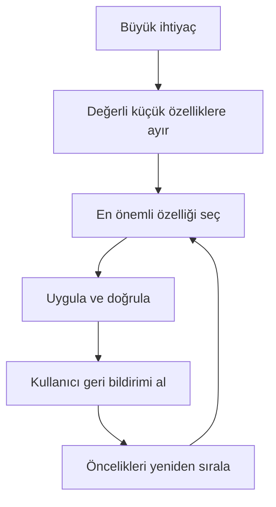

> Konu anlatımı: çevik düşüncenin neden ortaya çıktığı, temel değerleri, takım yapısı ve farklı geliştirme çerçeveleri.

## Bu notta neler var?

1. [Yazılım projelerinde belirsizlik ve başarısızlık kaynakları](#1-yazılım-projelerinde-belirsizlik-ve-başarısızlık-kaynakları)
2. [Çevik yaklaşım ve değerleri](#2-çevik-yaklaşım-ve-değerleri)
3. [Çevik ilkeler ve takım yapısı](#3-çevik-ilkeler-ve-takım-yapısı)
4. [Çevik ve geleneksel süreçlerin karşılaştırılması](#4-çevik-ve-geleneksel-süreçlerin-karşılaştırılması)
5. [Projeyi küçük parçalara ayırma ve geri bildirim](#5-projeyi-küçük-parçalara-ayırma-ve-geri-bildirim)
6. [Çevik çerçevelere genel bakış](#6-çevik-çerçevelere-genel-bakış)
7. [Çevik yaklaşımın güçlü yanları ve sınırları](#7-çevik-yaklaşımın-güçlü-yanları-ve-sınırları)

## 1. Yazılım projelerinde belirsizlik ve başarısızlık kaynakları

Bir yazılım projesi yalnızca kod yazmaktan ibaret değildir. Kullanıcı ihtiyacını anlamak, yapılacak işi sınırlandırmak, uygun bir ekip ve teknoloji seçmek, ürünü doğrulamak ve gerçek kullanımdan geri bildirim almak gerekir. Proje başında bütün ihtiyaçları kesin olarak bildiğimizi varsaymak çoğu zaman gerçekçi değildir: Kullanıcılar ürünü gördükçe neye ihtiyaç duyduklarını daha iyi ifade edebilir ve iş ortamı değişebilir.

Projelerin gecikmesine veya hedeflenen faydayı sağlayamamasına yol açabilen ortak riskler:

- Gereksinimleri kullanıcılarla birlikte yeterince açıklığa kavuşturmamak
- İş hedeflerini veya başarı ölçütlerini belirsiz bırakmak
- Ekibin becerilerini ve sorumluluklarını işe uygun belirlememek
- Bütçe, zaman, teknoloji ya da mimari konusunda gerçekçi olmayan varsayımlar
- Müşterinin proje boyunca geri bildirim vermesini sağlayamamak
- Büyük ve geç teslim edilen bir ürünün doğrulanmasını son aşamaya bırakmak
- Değişen koşullara uyum sağlayamamak

Eski ders slaytlarında farklı araştırmalardan tarihsel proje başarı oranları aktarılır. Bu sayılar belirli dönemlere, örneklemlere ve başarı tanımlarına bağlıdır; bugünkü tüm yazılım projeleri için evrensel ölçü olarak yorumlanmamalıdır. Öğretici olan nokta, başarısızlığın tek bir kodlama hatasından değil; hedef, iletişim, ekip, plan ve teknik kararların birlikte yönetilememesinden kaynaklanabilmesidir.

## 2. Çevik yaklaşım ve değerleri

**Çevik (agile) geliştirme**, ürünün küçük ve kullanılabilir parçalar halinde geliştirildiği, kısa döngüler sonunda incelendiği ve öğrenilenlere göre sonraki işlerin güncellendiği bir çalışma yaklaşımıdır. Çeviklik “plansız çalışmak” değildir. Planlama yapılır; plan, yeni bilgi geldikçe gerektiğinde gözden geçirilir.

Çevik Manifesto'nun dört değeri, soldaki seçeneği önemserken sağdakini bütünüyle reddetmez:

| Daha çok değer verilen | Değer verilmeye devam eden |
|---|---|
| Bireyler ve etkileşim | Süreçler ve araçlar |
| Çalışan yazılım | Kapsamlı dokümantasyon |
| Müşteriyle iş birliği | Sözleşme görüşmeleri |
| Değişime yanıt verebilmek | Bir plana bağlı kalmak |

Örneğin çalışan bir prototipi müşteriye erken göstermek, sadece ayrıntılı bir tasarım belgesi sunmaktan daha erken ve somut geri bildirim sağlar. Bu, tasarım belgelerinin gereksiz olduğu anlamına gelmez; gerekli dokümantasyon, işin ve bakımın ihtiyaçlarına göre hazırlanır.

## 3. Çevik ilkeler ve takım yapısı

Çevik ekipler için sık tekrarlanan çalışma ilkeleri şunlardır:

1. Kullanıcıya yararlı ve kaliteli yazılımı düzenli aralıklarla teslim etmek.
2. Gereksinim değişikliğini, projenin hangi aşamasında geldiğine bakmaksızın değerlendirmek.
3. Çalışan ürünü küçük artışlarla sunmak ve erken öğrenmek.
4. Alan uzmanlarıyla geliştiricilerin proje boyunca yakın çalışmasını sağlamak.
5. Takıma güvenmek, ihtiyaç duyduğu desteği vermek ve sorumluluk almasına imkân tanımak.
6. Bilginin ekip içinde doğrudan ve anlaşılır paylaşılmasını desteklemek.
7. İlerlemeyi yalnızca tamamlanan belgelerle değil, çalışan ve doğrulanabilir ürünle de ölçmek.
8. Uzun süre sürdürülebilecek bir iş temposu gözetmek.
9. Teknik kaliteye ve iyi tasarıma yatırım yapmak; bunlar değişiklik yapmayı kolaylaştırır.
10. Gereksiz işi ve karmaşıklığı azaltmak.
11. Çözümün ayrıntılarını, işi en iyi anlayan takımın şekillendirmesine imkân vermek.
12. Ekip çalışma biçimini düzenli olarak gözden geçirip iyileştirmek.

Çevik ekiplerin genellikle küçük, çapraz becerilere sahip ve kendini düzenleyen bir yapıda olması tercih edilir. İhtiyaca göre yazılım geliştiricileri, tasarımcılar, test uzmanları ve alan uzmanları birlikte çalışabilir. Ekip üyelerine yalnızca çözüm adımlarını vermek yerine problemi, beklenen sonucu ve kısıtları açıklamak; çözüm üretmelerini kolaylaştırır.

### Geri bildirim döngüsü

Her döngüde tüm ürünün bitmesi gerekmez; döngü sonunda çalışır, incelenebilir bir artış ve bir sonraki adımı besleyecek bilgi elde etmek hedeflenir.

## 4. Çevik ve geleneksel süreçlerin karşılaştırılması

Geleneksel ve çevik yöntemler farklı varsayımlara dayanır. Geleneksel, aşamalı ve kapsamı erken sabitlenmiş bir süreç bazı koşullarda uygundur; çevik yaklaşım ise değişen gereksinimleri kısa aralıklarla ele almaya elverişlidir.

| Boyut | Plan ağırlıklı, ardışık yaklaşım | Çevik, yinelemeli yaklaşım |
|---|---|---|
| Planlama ufku | Projenin büyük kısmını baştan planlama | Yakın dönem ayrıntılı, uzak dönem daha esnek |
| İlerleme işaretleri | Aşamalar ve ara belgeler | Çalışan ürün artışları ve tamamlanan işler |
| Müşteri katılımı | Başta ve kilometre taşlarında yoğunlaşabilir | Geliştirme boyunca düzenli |
| Gereksinimler | Başlangıçta kararlı oldukları varsayılır | Öğrenildikçe öncelik ve kapsam güncellenebilir |
| Sorunları fark etme | Sonraki entegrasyon veya teslim aşamalarında olabilir | Küçük teslimler ve sık incelemelerle daha erken |
| Değişiklik maliyeti | Geç aşamada yüksek olabilir | Küçük parçalara ayırma etkisini azaltabilir |

Bu tablo hiçbir sürecin her projede üstün olduğunu söylemez. Gereksinimler kararlı, sözleşme veya mevzuat kaynaklı izlenebilirlik yüksek ve teslimat tek parça olmak zorundaysa plan ağırlıklı yöntemler uygun olabilir. Ürün keşif gerektiriyor, kullanıcıya erişim mümkün ve iş küçük artışlarla değer üretebiliyorsa çevik yaklaşım yararlı olabilir. Büyük projeler de çevik çalışabilir; bunun için ekipler arası bağımlılıkların ve ortak mimarinin ayrıca yönetilmesi gerekir.

## 5. Projeyi küçük parçalara ayırma ve geri bildirim

Büyük bir hedefi küçük, incelenebilir işlere bölmek, yanlış varsayımın uzun süre fark edilmeden kalma riskini azaltır. İş parçalarının mümkün oldukça kullanıcıya anlamlı değer sağlaması, “bitti” durumunun açıkça tanımlanması ve ekipçe test edilebilir olması gerekir.

### Basit bir çevik ürün akışı

Örnek: “Bir çevrim içi mağaza geliştirmek” çok geniş bir hedef. İlk küçük artış, ürünleri görme ve bir ürünü sepete ekleme olabilir. Sonraki artışta sepeti saklama veya ödeme akışı eklenebilir. Bu sırada kullanıcıların davranışı bir sonraki önceliği değiştirebilir.

## 6. Çevik çerçevelere genel bakış

Çeviklik tek bir yöntem veya ürün değildir. Farklı çerçeveler yineleme, geri bildirim ve iş birliği değerlerini kendi uygulamalarıyla hayata geçirir:

| Yaklaşım | Temel odak |
|---|---|
| Scrum | Zaman kutulu sprintler, roller, etkinlikler ve ürün artışı |
| Extreme Programming (XP) | Teknik mühendislik pratikleri, kısa sürümler, test ve basit tasarım |
| Feature-Driven Development (FDD) | Kullanıcıya değer sunan, küçük özellikler çevresinde yinelemeli çalışma |
| Rational Unified Process (RUP) | Riskleri ve kullanım senaryolarını dikkate alan yinelemeli geliştirme çerçevesi |
| Lean yazılım geliştirme | İsrafı azaltma ve akışta değer üretmeye odaklanma |
| Dynamic Systems Development Method (DSDM) | İş ihtiyacı, kullanıcı katılımı ve zaman/kaynak kısıtları içinde önceliklendirme |

FDD'de sistemin kapsamı ve özellikleri anlaşılır biçimde tanımlanır, özellikler küçük teslim edilebilir işlere dönüştürülür. Yineleme kısa tutulur ve sonuç görünür kılınır. RUP, geliştirme işini kullanım senaryoları ve yinelemeler etrafında düzenler; proje yönetimi, mimari ve değişen ihtiyaçlara ilişkin yön sağlar. XP'de sık entegrasyon, test odaklı çalışma, basit tasarım ve kodu iyileştirme (refactoring) gibi mühendislik uygulamaları ön plana çıkar.

Bu yaklaşımların adları benzer olsa da kapsamları aynı değildir: Scrum işin düzenlenmesini ve gözden geçirilmesini tanımlar; XP gibi yöntemler günlük teknik geliştirme uygulamalarını da açıkça tarif eder. Bir takım çerçeveye göre çalışırken uygun mühendislik pratiklerini ayrıca seçebilir.

## 7. Çevik yaklaşımın güçlü yanları ve sınırları

**Olası yararlar**

- Kullanıcıya yararlı özellikleri daha erken gösterme
- Gereksinim ve risk sorunlarını daha erken öğrenme
- Öncelikleri yeni bilgiye göre güncelleme
- İş ilerleyişini küçük ürün artışları üzerinden görünür kılma
- Takımın sahiplenmesini ve öğrenmesini destekleme

**Dikkat edilmesi gerekenler**

- Müşteri veya alan uzmanı düzenli olarak katılamazsa geri bildirim döngüsü zayıflar.
- Birden fazla karar vericinin öncelikleri uyuşmazsa iş listesi sık sık yön değiştirebilir.
- Ekip, test ve tasarım kalitesini korumazsa hızlı teslimat teknik borç biriktirebilir.
- Her iş küçük ve bağımsız parçalara ayrılamayabilir.
- Sözleşmeler, mevzuat ve kapsam yönetimi de yineleme planıyla uyumlu tasarlanmalıdır.

### Kendini dene

1. “Çalışan yazılım, ayrıntılı dokümantasyondan daha önemlidir” sözü dokümantasyonu tamamen bırakmayı mı önerir? Neden?
2. Değişen gereksinimin kabul edilmesi ile her yeni isteğin hemen eklenmesi arasındaki fark nedir?
3. Kısa geri bildirim döngüsü hangi proje risklerini azaltabilir?
4. Plan ağırlıklı yaklaşımın çevik yaklaşımdan daha uygun olabileceği bir durum örneği ver.

