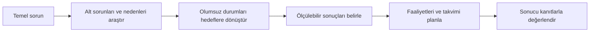

> Konu anlatımı: bir fikri uygulanabilir projeye dönüştürme, sorun ve hedef analizi, araştırma süreci ve proje seçimi.

## 1. Fikir ile proje arasındaki fark

Bir fikir, çözüm olabilecek bir düşüncedir. **Proje** ise belirli bir süre ve kaynak sınırı içinde, tanımlanmış amaçlara ulaşmak için yürütülen, başlangıç ve bitiş noktası olan faaliyetlerin bütünüdür. Bir fikri uygulanabilir proje haline getirmek için nerede uygulanacağı, kimler için değer üreteceği, hangi işler yapılacağı, ne zaman tamamlanacağı ve hangi kaynakların gerektiği açıklığa kavuşturulur.

| Proje bileşeni | Sorulacak soru |
|---|---|
| İhtiyaç ve amaç | Hangi soruna, kim için çözüm aranıyor? |
| Yer ve hedef kitle | Çözüm nerede, kimler tarafından kullanılacak? |
| Faaliyetler | Amaca ulaşmak için hangi işler yapılacak? |
| Zaman | Başlangıç, kilometre taşları ve bitiş ne zaman? |
| Kaynak ve bütçe | İnsan gücü, araç ve mali kaynaklar neler? |
| Sonuç ve değerlendirme | Proje sonunda hangi kanıtla başarı anlaşılacak? |

Bir proje fikri, bu sorulara makul yanıtlar üretmeye başlayınca değerlendirilip planlanabilir hale gelir. Erken aşamada belirsizlik olması normaldir; önemli olan belirsizlikleri gizlemek yerine varsayım, risk ve araştırma konusu olarak görünür kılmaktır.

## 2. Sorun analizi ve hedef analizi

**Sorun analizi**, proje ekibinin etkileyebileceği temel sorunu ve ona yol açan veya ondan etkilenen alt sorunları ayırt etmeye yarar. Yüzeyde görünen belirtiyi asıl sorun sanmak, doğru çözümü seçmeyi güçleştirir.

**Hedef analizi**, sorun cümlelerini istenen olumlu duruma dönüştürür. Hedef, faaliyetle karıştırılmamalıdır:

| Faaliyet (yapılacak iş) | Beklenen sonuç / hedef |
|---|---|
| Öğrencilere kodlama eğitimi düzenlemek | Öğrencilerin temel algoritma problemlerini çözme becerisini geliştirmek |
| Bir bilgisayar sınıfı kurmak | Öğrencilerin uygulamalı derslere erişimini artırmak |
| Bir uygulama geliştirmek | Kullanıcıların belirli bir işlemi daha hızlı ve doğru tamamlamasını sağlamak |

Bir projenin **genel amacı** temel sorunun iyileştirilmesine katkıyı açıklar. **Özel amaçlar** ise proje sonunda gözlenebilir veya ölçülebilir sonuçları belirtir. Uygulanabilir hedef; kimin için, hangi koşulda, hangi ölçütle ve ne zamana kadar gerçekleşeceği anlaşılabilecek kadar belirgindir.

## 3. Araştırma projesi nedir?

Araştırma projesi, bir soruyu yöntemli biçimde inceleyip kanıta dayalı sonuç üretmeye çalışır. Literatür taraması araştırmanın önemli bir parçasıdır, fakat tek başına araştırma sorusu, yöntem, veri ve analiz içeren araştırmanın tamamı değildir.

### Araştırma akışı

1. Konuyla ilgili mevcut çalışmaları bul ve kaynakları değerlendir.
2. Çalışmaları okuyup ortak bulguları, farklılıkları ve açık soruları not et.
3. Sınırları belirli bir araştırma sorusu oluştur.
4. Soruyu yanıtlamaya uygun analiz yöntemini seç.
5. Gerekli verileri etik ve tutarlı biçimde topla.
6. Veriyi belirlenen yöntemle analiz et.
7. Bulguların ne anlama geldiğini, sınırlılıklarıyla birlikte yorumla.
8. Yöntemi, bulguları ve kaynakları raporla.

Araştırma sorusu ile çözüm önerisini birbirinden ayırmak önemlidir. “Bir mobil uygulama yapacağız” bir faaliyet veya çözüm fikridir; araştırma sorusu ise bu çözümün hangi kullanıcı sorununu nasıl etkilediğini sınayabilir.

## 4. Proje seçimi ve değerlendirme

Bir proje fikrini seçerken şu soruları kullan:

- Hangi gerçek ihtiyacı ele alıyor?
- Sorun kimleri, ne ölçüde etkiliyor?
- Önerilen sonuç hedef kitle için ne kadar değerli?
- Fikir mevcut çözümlerden hangi yönüyle ayrılıyor?
- Öngörülen faaliyetler süre ve kaynaklarla gerçekleştirilebilir mi?
- Sonuç ölçülebilir mi; başarıyı hangi veri veya kanıt gösterecek?
- Çözümün geliştirilmesi ve bakımı sürdürülebilir mi?
- Yeni bir yöntem veya ürün bileşeni deneniyorsa temel riskleri nelerdir?

Bir fikir önemli ve yenilikçi görünse bile hedef kitle, veri erişimi, süre, maliyet veya uygulama yeri belirsizse proje planı henüz olgunlaşmamış olabilir. Küçük bir ön araştırma veya prototip, en kritik varsayımları sınamaya yardım eder.

### Kendini dene

1. “Bir web sitesi kurmak” neden tek başına ölçülebilir proje amacı değildir?
2. Sorun analizi ile hedef analizi arasındaki ilişkiyi bir örnekle açıkla.
3. Faaliyet, çıktı ve özel amaç için birer örnek ver.
4. Literatür taraması neden araştırma sürecinin tamamı sayılmaz?

