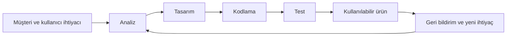
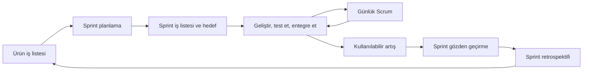
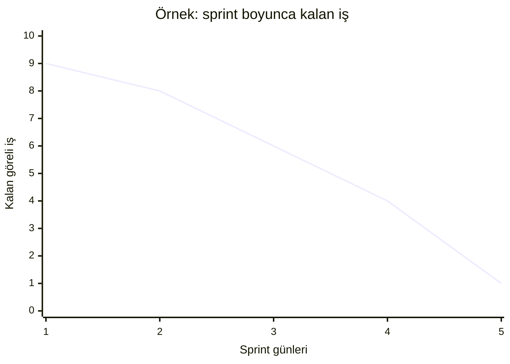

> Konu anlatımı: çevik proje yönetimi, Scrum'ın rol ve etkinlikleri, ürün iş listeleri, kullanıcı hikâyeleri ve ilerleme takibi.

## İçindekiler

1. [Proje yönetiminin dengeleri](#1-proje-yönetiminin-dengeleri)
2. [Scrum'ın çerçevesi](#2-scrumın-çerçevesi)
3. [Scrum rolleri](#3-scrum-rolleri)
4. [Scrum etkinlikleri ve sprint akışı](#4-scrum-etkinlikleri-ve-sprint-akışı)
5. [Ürün iş listesi ve kullanıcı hikâyeleri](#5-ürün-iş-listesi-ve-kullanıcı-hikâyeleri)
6. [Tahmin, sprint iş listesi ve burndown](#6-tahmin-sprint-iş-listesi-ve-burndown)
7. [Scrum tahtası, sürüm planı ve yalın öğrenme](#7-scrum-tahtası-sürüm-planı-ve-yalın-öğrenme)
8. [Yararlar, güçlükler ve uygulama örnekleri](#8-yararlar-güçlükler-ve-uygulama-örnekleri)

## 1. Proje yönetiminin dengeleri

Bir yazılım projesi, kapsam, zaman ve maliyet gibi kısıtları; kalite ve beklenen iş değerini birlikte yönetir. Bu boyutlardan birinde yapılan değişiklik diğerlerini etkileyebilir. Örneğin teslim tarihi sabitse, bütün özellikleri aynı tarihe sığdırmak yerine en değerli özellikleri öne almak ve geri kalan kapsamı yeniden görüşmek gerekebilir.

Yazılım geliştirme zinciri, ihtiyacın anlaşılmasından ürünün çalışır hale gelmesine kadar ilerler:

İlk teslim edilen parça, tüm ürünün bitmiş olması değil; kullanıcıya gösterilip doğrulanabilecek bir artış olabilir. Bu yaklaşım, kapsam veya beklenti uyuşmazlığını son aşamada ortaya çıkarmak yerine erken öğrenmeye yardım eder.

## 2. Scrum'ın çerçevesi

Scrum, karmaşık ürün çalışmalarını küçük ve sabit süreli **sprintler** içinde düzenlemek için kullanılan çevik bir çerçevedir. Takım her sprint için bir hedef belirler, işe yarayan bir ürün artışı üretmeye çalışır ve sprint sonunda sonuçları inceler. Ardından ürün ve çalışma yöntemi hakkında öğrendiklerini sonraki sprintte kullanır.

Sprint sırasında takım, seçtiği hedefe odaklanır. Ürün hakkında yeni bilgi ortaya çıkarsa ürün iş listesi güncellenebilir; bu, mevcut sprint hedefine gelişigüzel ek iş yüklemekten farklıdır. Sprint sonunda “çalıştı” demek tek başına yeterli değildir: Tamamlanan işin kalite ölçütlerini ve tanımlı tamamlanma koşullarını karşılaması gerekir.

## 3. Scrum rolleri

Scrum'da sorumluluklar, bir geleneksel proje yöneticisinin tüm işi ve çözümü ekip adına belirlemesi şeklinde düzenlenmez. Takım çalışmayı görünür tutar, karar verir ve ürün hedefine katkı sağlar.

| Sorumluluk | Temel görevi |
|---|---|
| Ürün Sahibi (Product Owner) | Ürün değerini artırmak; ihtiyacı görünür kılmak, ürün iş listesini düzenlemek ve öncelikleri açıklamak |
| Scrum Master | Scrum'ın anlaşılmasını ve doğru uygulanmasını kolaylaştırmak; engelleri gidermeye ve iş birliğine yardımcı olmak |
| Geliştirme Takımı | Seçilen işi planlamak, ürünü geliştirmek, test etmek ve tamamlanmış artışı sunmak |

Ürün Sahibi farklı paydaşlardan gelen beklentileri ürünün amacıyla birleştirir ve yapılacak işleri öncelik sırasına koyar. Bu, her paydaşın tüm isteklerini aynı anda yapma sözü değildir.

Scrum Master takımın yöneticisi veya iş atayan kişi değildir. Takımın kendi kendini yönetmesini, engellerin ele alınmasını ve etkinliklerin amacına uygun yürütülmesini destekler. Geliştirme takımı da taahhüt ettiği işi nasıl gerçekleştireceğine karar verir; takımda geliştirme, test ve tasarım gibi farklı beceriler bulunabilir.

Slayt kaynaklarında takım büyüklüğüne ilişkin farklı dönemlerde kullanılmış sayısal aralıklar geçer. Bunlar evrensel sabit kural olarak değil; küçük iletişim maliyeti ve işin tamamlanması için gereken beceri dengesi olarak anlaşılmalıdır. Güncel resmi Scrum rehberi, ekip yapısını ve büyüklüğünü ayrıca tanımlar.

## 4. Scrum etkinlikleri ve sprint akışı

### Sprint planlama

Takım sprintin amacını, bu sprintte hangi işlerin değer sağlayabileceğini ve seçilen işi nasıl tamamlayacağını birlikte planlar. Ürün iş listesi aday işlerin kaynağıdır. Planlamada ürün amacı, öncelik, bağımlılıklar, kapasite ve risk dikkate alınır.

### Günlük Scrum

Günlük Scrum, geliştirme takımının ilerleyişi ve sprint hedefi doğrultusunda planını uyarlaması için yapılan kısa, düzenli eşgüdüm etkinliğidir. Engellerin ve yeni bağımlılıkların görünür olması yararlıdır; uzun tartışma ve ayrıntılı sorun çözme gerekiyorsa ilgili kişiler toplantı sonrasında bir araya gelebilir. Amaç yöneticilere rapor vermek değil, takımın kendi çalışmasını koordine etmesidir.

### Sprint gözden geçirme (review)

Sprint sonunda ürün artışı paydaşlarla incelenir. Ne tamamlandı, hangi sonuç elde edildi, ürünün sonraki adımları ne olmalı ve değişen ihtiyaçlar var mı sorularına bakılır. Bu etkinlik yalnızca bir sunum değildir; iş birliği ve ürün kararları için geri bildirim fırsatıdır.

### Sprint retrospektifi

Takım kendi çalışma biçimini gözden geçirir: Neler iyi gitti, hangi sorunlar çıktı, bir sonraki sprintte hangi somut iyileştirme denenecek? Retrospektif, ürünü değil öncelikle ekip sürecini iyileştirmeye yöneliktir.

## 5. Ürün iş listesi ve kullanıcı hikâyeleri

**Ürün iş listesi (Product Backlog)**, ürün amacı için yapılabilecek işlerin sıralı ve sürekli güncellenen listesidir. İstekleri tek tek bir belgeye yazmaktan fazlasıdır: Ürün Sahibi ve takım işlerin kapsamını, değerini, belirsizliğini ve bağımlılıklarını geliştikçe netleştirir. Liste değişebilir; en yüksek öncelikli işlerin daha ayrıntılı anlaşılması beklenir.

**Kullanıcı hikâyesi (user story)**, kullanıcıya değer sağlayan bir ihtiyacı kısa ve anlaşılır biçimde ifade etmenin yaygın bir yoludur. Özgün bir örnek:

> Bir kurs öğrencisi olarak, internet bağlantım olmadığında da notları okuyabilmek istiyorum; böylece ders materyallerini çevrim dışı çalışabilirim.

Hikâye, çözümün tüm ayrıntılarını tek başına tanımlamaz. Takım ve paydaşlar kabul ölçütleri, tasarım ve teknik seçenekler üzerine konuşur. Büyük hikâyeler, test edilebilir ve kullanıcıya yarar sağlayan küçük parçalara ayrılır.

## 6. Tahmin, sprint iş listesi ve burndown

Her iş aynı karmaşıklıkta veya belirsizlikte değildir. Scrum takımları göreli tahmin, örneğin hikâye puanları kullanabilir. Bazı ekipler puanlamada 1, 2, 3, 5, 8, 13 gibi artan aralıklı değerleri kullanır; bunlar saat değildir ve bütün ekipler için zorunlu standart değildir. Ekipçe kalibre edilmiş karşılaştırma aracıdır.

**Sprint iş listesi (Sprint Backlog)**, sprint hedefi doğrultusunda seçilen işleri ve takımın o işleri tamamlamak için izlediği planı görünür kılar. Hedef, seçilmiş her işin mutlaka teslim edileceğine dair kör bir söz değil; takımın çalışma boyunca uyum sağlayacağı odaktır.

**Burndown grafiği**, zaman içinde tamamlanmamış tahmini işin nasıl azaldığını göstermek için kullanılabilir. Kalan işi gün veya sprint boyunca grafikleyerek sapmaları fark etmek kolaylaşır; ancak tek başına grafik kalitenin, kullanıcı değerinin veya ürün başarısının ölçüsü değildir.

Hikâyeler ve sprint işlerinin seçimi önceliğe, kapasiteye, belirsizliğe ve bağımlılıklara dayanır. Takım, tahminini geçmiş deneyimiyle günceller. Bir işin boyutunu poker kartlarıyla tartışmak, farklı anlayışları ortaya çıkarabilir; oylama ortak bir tahmin üretmeye yardım eder, doğruluk garantisi vermez.

## 7. Scrum tahtası, sürüm planı ve yalın öğrenme

Scrum veya Kanban tahtası, işin durumunu görünür kılabilir. Basit bir tahta örneği:

| Yapılacak | Devam ediyor | İnceleme / test | Tamamlandı |
|---|---|---|---|
| Giriş akışını tasarla | Not aramasını geliştir | Çevrim dışı kullanım testi | Hafta listesi |

Tahta, takımın gerçek iş akışına göre düzenlenir. Sadece kartları sütundan sütuna taşımak ürün üretmez; “tamamlandı” tanımı, kalite ölçütleri ve sprint hedefi açık olmalıdır.

**Sürüm planı**, kullanıcıya hangi ürün artışlarının ve hangi önceliklerin ne zaman sunulabileceğine dair tahmini bir görünüm verir. Sprint planı yakındaki işi ayrıntılandırırken, sonraki sürüm tahminleri yeni bilgi geldikçe değişebilir.

Yalın yaklaşım, kullanıcı değeri üretmeyen işi azaltmayı ve öğrenme döngüsünü kısaltmayı vurgular. Bir prototip veya erken sürüm, varsayımları daha erken sınamaya yarar; ancak tamamlanmamış ürünü üretim kalitesinde gibi göstermek veya testleri atlamak anlamına gelmez.

## 8. Yararlar, güçlükler ve uygulama örnekleri

**Yararlar:** işin ve engellerin görünür olması, küçük teslimlerle erken geri bildirim, önceliklerin güncellenebilmesi, takımın iş üzerindeki sahiplenmesi.

**Güçlükler:** müşterinin düzenli katılımını koruma, farklı paydaşların çatışan öncelikleri, sık değişiklikler nedeniyle odak kaybı, teknik kaliteye yeterince yatırım yapılmaması, büyük takımların koordinasyonu ve sözleşmelerin esnek teslimlere uyarlanması.

Scrum, küçük ekipler dışında da kullanılabilir; çok takımlı çalışmada ekipler arası bağımlılıklar, ortak ürün hedefi ve entegrasyon yönetilmelidir. Kaynak slaytlarda FBI'ın Sentinel sistemi ve GOV.UK gibi vaka örnekleri ile anket iddiaları yer alır. Bunlar farklı ölçeklerde çevik çalışmanın tartışılması için yararlıdır; kaynakta özetlenen eski sonuçlar tek başına çevik yöntemin her projede daha iyi sonuç vereceğinin kanıtı değildir.

### Scrum terimlerini eşleştir

| Soru | Kavram |
|---|---|
| Ürünün değerini ve iş sırasını kim netleştirir? | Ürün Sahibi |
| Takımın Scrum'ı anlamasını ve engellerin ele alınmasını kim kolaylaştırır? | Scrum Master |
| Seçilen işin nasıl yapılacağına ve artışın geliştirilmesine kim karar verir? | Geliştirme Takımı |
| Ürün için yapılabilecek işlerin sıralı kaynağı nedir? | Ürün iş listesi |
| Sprint sırasında takımın seçtiği iş ve plan nedir? | Sprint iş listesi |
| Sprint sonunda ürün ve bir sonraki yön hakkında hangi etkinlik yapılır? | Sprint gözden geçirme |
