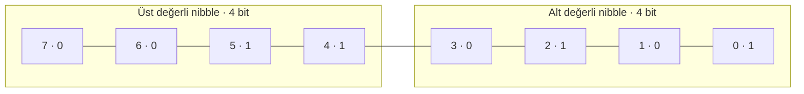
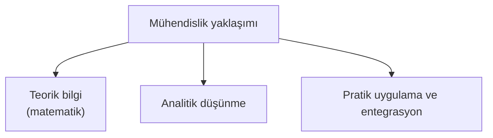
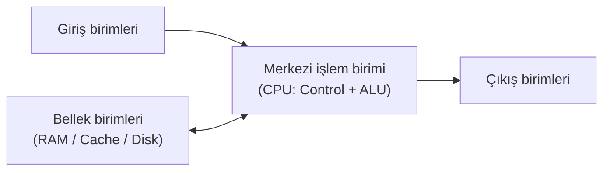
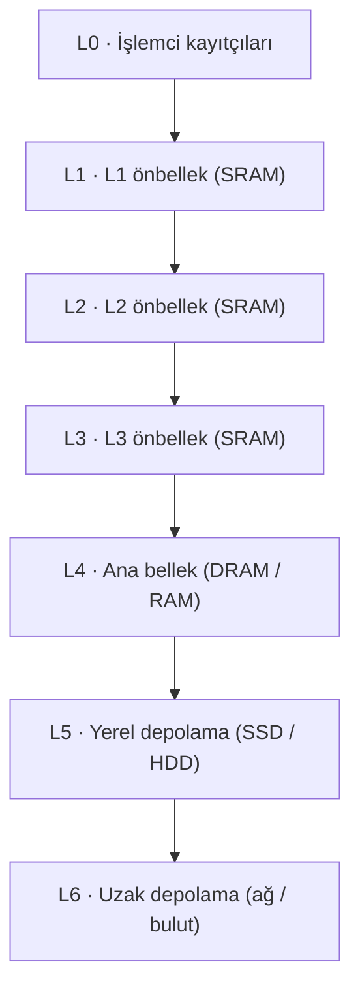
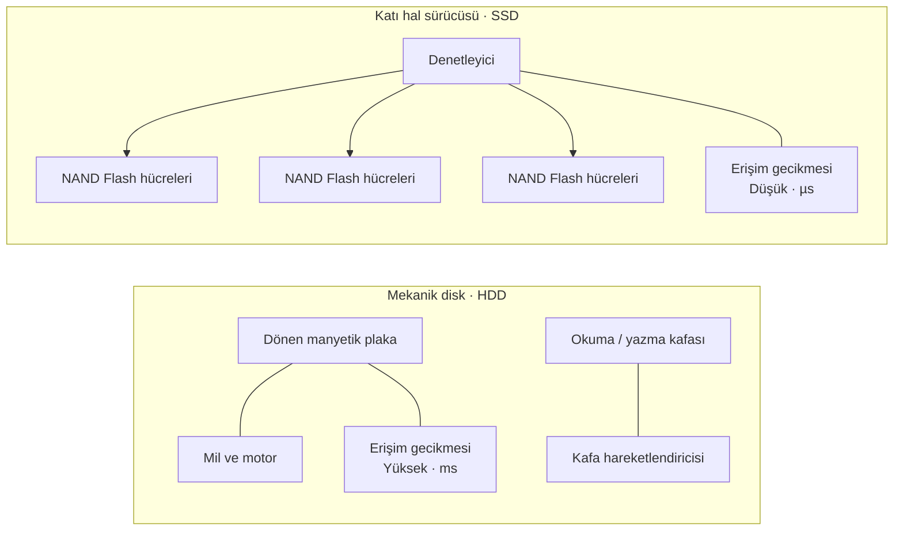
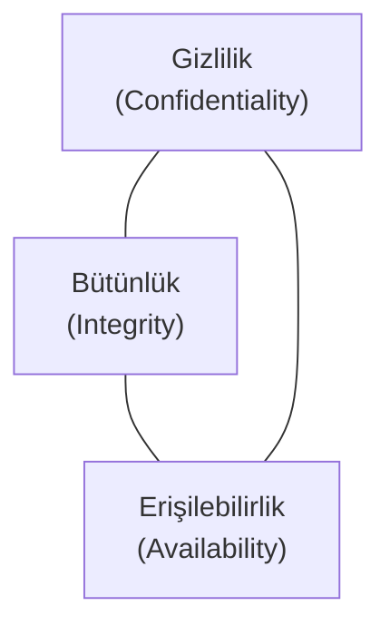

> **Konu Kapsamı:** Bilgisayar ölçü ve veri birimleri, görüntü/çözünürlük ve renk derinliği analizi, hız/performans ölçüleri, bilgisayar ve yazılım mühendisliği disiplinleri/görevleri, donanım mimarileri (CPU, GPU, TPU, FPGA), L0-L6 bellek hiyerarşisi, depolama teknolojileri (HDD vs SSD anatomisi), giriş/çıkış ve ağ donanımları, işletim sistemleri, yazılım/algoritma temelleri, veritabanları (RDBMS vs NoSQL) ve bilgi güvenliği standartları/mevzuatı.

---

## İçindekiler

1. [Veri ve Depolama Birimleri](#1-veri-ve-depolama-birimleri)
2. [Görüntü Boyutu, Çözünürlük, Renk ve Ekran Teknolojileri](#2-görüntü-boyutu-çözünürlük-renk-ve-ekran-teknolojileri)
3. [Hız, Frekans ve Performans Ölçüleri](#3-hız-frekans-ve-performans-ölçüleri)
4. [Bilgisayar ve Yazılım Mühendisliği Disiplinleri](#4-bilgisayar-ve-yazılım-mühendisliği-disiplinleri)
5. [Donanım Bileşenleri ve İşlem Mimarileri](#5-donanım-bileşenleri-ve-işlem-mimarileri)
6. [L0 - L6 Bellek Hiyerarşisi ve Depolama Teknolojileri](#6-l0---l6-bellek-hiyerarşisi-ve-depolama-teknolojileri)
7. [Giriş/Çıkış (I/O) Birimleri ve Ağ Donanımları](#7-girişçıkış-io-birimleri-ve-ağ-donanımları)
8. [Gerçek Sistem Karşılaştırmaları (Raspberry Pi vs Dizüstü)](#8-gerçek-sistem-karşılaştırmaları-raspberry-pi-vs-dizüstü)
9. [İşletim Sistemleri, Yazılım, Veritabanları ve Güvenlik Standartları](#9-işletim-sistemleri-yazılım-veritabanları-ve-güvenlik-standartları)
10. [Sınava Hazırlık Örnek Soruları ve Çözümleri](#10-sınava-hazırlık-örnek-soruları-ve-çözümleri)

---

## 1. Veri ve Depolama Birimleri

Bilgisayar sistemleri tüm veri ve komutları ikilik (**Binary**) sayı sistemindeki `0` ve `1` durumlarıyla temsil eder. 

### 1.1 Temel Veri Genişlikleri

* **Bit (b):** $0$ veya $1$ değerini alabilen en küçük mantıksal veri birimidir.
* **Nibble (N):** $4$ bit'ten oluşan veri birimidir.
* **Byte (B):** $8$ bit'ten oluşan temel adresleme ve karakter temsil birimidir.
* **Word (İşlemci Kelimesi):** $32$ bit ($4$ byte) genişliğindeki veri yapısıdır.
* **Double Word (DWord):** $64$ bit ($8$ byte) genişliğindeki veri yapısıdır.
* **Quad Word (QWord):** $128$ bit ($16$ byte) genişliğindeki veri yapısıdır.

### 1.2 Bellek Kapasite Birimleri Tablosu (İkili / 1024 Tabanlı)

Bilgisayar hafızasında (RAM), sabit disklerde veya ağ aktarımlarında veri boyutunu ifade ederken ikili üstel ($2^{10} = 1024$) katlar esas alınır:

| Metrik | Sembol | Değer ($1024$ Tabanlı) | Bayt Karşılığı (Tam Değer) |
| :--- | :--- | :--- | :--- |
| **Bayt** | B | $1$ | $1$ Byte |
| **Kilobayt** | KB | $1024^1$ | $1.024$ Byte |
| **Megabayt** | MB | $1024^2$ | $1.048.576$ Byte |
| **Gigabayt** | GB | $1024^3$ | $1.073.741.824$ Byte |
| **Terabayt** | TB | $1024^4$ | $1.099.511.627.776$ Byte |
| **Petabayt** | PB | $1024^5$ | $1.125.899.906.842.624$ Byte |
| **Eksabayt** | EB | $1024^6$ | $1.152.921.504.606.846.976$ Byte |
| **Zettabayt** | ZB | $1024^7$ | $1.180.591.620.717.411.303.424$ Byte |
| **Yottabayt** | YB | $1024^8$ | $1.208.925.819.614.629.174.706.176$ Byte |

> **Not (SI vs Binary Standartları):** Ticari üreticiler (HDD/SSD etiketlerinde) SI standardını ($10^3 = 1000$) kullanarak $1 \text{ TB} = 1.000.000.000.000 \text{ Byte}$ olarak kabul eder. İşletim sistemleri ise $2^{40} = 1.099.511.627.776 \text{ Byte}$ esasına göre hesaplama yaptığından $1\text{ TB}$ disk sistemde $\approx 931 \text{ GiB}$ olarak görüntülenir.

### 1.3 1 Terabayt (TB) Kapasitenin Somut Karşılıkları

* **Fiziksel Medya Karşılığı:** $1\text{ TB}$ veri saklamak için **$728.177$ adet $1.44\text{ MB}$ Floppy Disket** veya **$1.498$ adet $700\text{ MB}$ CD-ROM** gereklidir.
* **Fotoğraf Saklama:** $\approx 200.000$'den fazla yüksek kaliteli RAW formatında fotoğraf veya $\approx 130.000$ dijital standart fotoğraf.
* **Video / Film:** Standard Definition (SD) kalitesinde $\approx 200$ adet $2$ saatlik film koleksiyonu veya yüzlerce saatlik 4K video kaydı.
* **Müzik:** $5\text{ MB}$ ortalama büyüklüğe sahip MP3 formatında $\approx 200.000$ şarkı.
* **Süper Bilgisayar Kıyası:** IBM Watson süper bilgisayarı $16\text{ TB}$ RAM hafızasına sahiptir.
* **Hubble Uzay Teleskobu:** Yılda yaklaşık $10\text{ TB}$ yeni veri üretmektedir.

---

## 2. Görüntü Boyutu, Çözünürlük, Renk ve Ekran Teknolojileri

Dijital görüntü; matrisel dizilimdeki renkli noktaların birleşimiyle oluşur.

### 2.1 Çözünürlük ve Ekran Terimleri

* **Piksel (Pixel - Picture Element):** Ekranlarda ve dijital görüntülerde adreslenebilir en küçük renkli birimdir.
* **Inch (İnç):** $1 \text{ İnç} = 2.54 \text{ cm}$ olan uzunluk ölçü birimidir. Ekran boyutları çapraz (diyagonal) olarak inç cinsinden ölçülür.
* **Çözünürlük (Resolution):** Görüntünün yatay ve dikey piksel boyutudur ($W \times H$). 
  * Örn: Full HD ($1920 \times 1080$) $= 2.073.600$ Piksel ($\approx 2.07\text{ MP}$).
  * QHD+ ($2560 \times 1600$) $= 4.096.000$ Piksel.
* **En-Boy Oranı (Aspect Ratio):** Ekran genişliğinin yüksekliğine oranıdır ($16:9$, $4:3$, $1:1$, $9:16$).
* **DPI (Dots Per Inch):** Yazıcı ve baskı aygıtlarında inç başına düşen fiziki nokta sayısıdır.
  * **$72\text{ DPI}$ (Düşük):** Ekran görünümü için yeterli fakat baskıda pikselleşmeye yol açar.
  * **$150 - 200\text{ DPI}$ (Orta):** Standart ofis belgeleri ve basit baskılar için uygundur.
  * **$300+\text{ DPI}$ (Yüksek):** Profesyonel fotoğraf, afiş ve kaliteli baskı projelerinde kullanılır.
* **PPI (Pixels Per Inch):** Ekran veya dijital tarayıcılarda inç başına düşen piksel yoğunluğudur. PPI arttıkça ekran netliği artar.

### 2.2 Bit Derinliği (Bit Depth) ve Renk Kodlaması

Bit derinliği, her pikselin rengini ve gri tonunu ifade etmek için ayrılan bit sayısıdır ($2^n$ renk seçeneği).

* **$1\text{-bit}$ Derinlik:** $2^1 = 2$ Renk (Sadece Siyah-Beyaz).
* **$8\text{-bit}$ Derinlik:** $2^8 = 256$ Gri tonu veya renk seçeneği ($0 =$ Siyah, $255 =$ Beyaz).
* **$24\text{-bit}$ True Color (RGB):** Kırmızı (R), Yeşil (G) ve Mavi (B) kanallarının her biri için $8\text{ bit}$ ayrılır ($8+8+8 = 24\text{ bit}$).
  * Her kanalda $256$ ton $\implies 256 \times 256 \times 256 = 16.777.216$ olası renk.
  * Örnek Hex kodları: Kırmızı (`0xFF0000`), Yeşil (`0x00FF00`), Mavi (`0x0000FF`).
* **$30\text{-bit}$ ($10\text{-bit}$/kanal):** $1024 \times 1024 \times 1024 = 1.073.741.824$ renk ($1.07$ Milyar renk).
* **$36\text{-bit}$ ($12\text{-bit}$/kanal):** $4096 \times 4096 \times 4096 = 68.719.476.736$ renk ($68+$ Milyar renk).

### 2.3 Sıkıştırılmamış Görüntü Bellek Hesabı

Ham (raw) bir görüntünün RAM veya diskte kapladığı alan:

$$
\text{Boyut (Byte)} = \frac{\text{Genişlik} \times \text{Yükseklik} \times \text{Bit Derinliği}}{8}
$$

**Örnek Hesaplama:** $1000 \times 1000$ piksel boyutunda, $24\text{-bit}$ renk derinliğine sahip ham görsel:
$$
\text{Boyut} = \frac{1000 \times 1000 \times 24}{8} = 3.000.000 \text{ Byte} \approx 2.86 \text{ MB}
$$

### 2.4 Yenileme Hızı (Refresh Rate)

Ekranın görüntüyü saniyede kaç kez güncellediğini ifade eder ve Hertz ($\text{Hz}$) ile ölçülür. 
* $60\text{ Hz}$, $90\text{ Hz}$, $120\text{ Hz}$, $240\text{ Hz}$ gibi değerler daha akıcı görüntü sağlar.

---

## 3. Hız, Frekans ve Performans Ölçüleri

Sistem bileşenlerinin çalışma hızları ve veri aktarım oranları farklı performans ölçütleri ile ifade edilir.

### 3.1 Temel Hız ve Performans Birimleri

| Birim | Açılımı | Açıklama / Kullanım Alanı |
| :--- | :--- | :--- |
| **Hz / GHz** | Hertz / Gigahertz | Saniyedeki devir/çevrim sayısı. İşlemci saat frekansı. |
| **FLOPS** | Floating Point Operations Per Second | Saniyedeki kayan nokta (reel sayı) işlem sayısı. Süper bilgisayar başarım ölçütü. |
| **MIPS** | Millions Instructions Per Second | Saniyede yürütülen milyon cinsinden komut sayısı. |
| **bps / Bps** | bits per second / Bytes per second | Saniyedeki aktarılan bit ($b$) veya Byte ($B$) sayısı. Ağ bant genişliği. |
| **RPM** | Revolutions Per Minute | Dakikadaki devir sayısı. Mekanik sabit disklerin (HDD) dönüş hızı ($5400$, $7200\text{ RPM}$). |

### 3.2 Frekans ve Ampul İllüstrasyonu (50 Hz Şebeke Mantığı)

Frekans kavramını anlamak için elektrik şebekeleri örnek verilir:
* $50\text{ Hz}$ alternatif akım (AC) ile çalışan bir ampul, saniyede $100$ ila $120$ kez yanıp sönme döngüsü gerçekleştirir. 
* Bu hız insan gözünün algılama sınırının çok üzerinde olduğu için ampul kesintisiz yanıyor gibi görünür. İşlemcilerdeki Gigahertz ($\text{GHz}$) seviyeleri saniyede milyarlarca çevrimi ifade eder.

---

## 4. Bilgisayar ve Yazılım Mühendisliği Disiplinleri

Bilgisayar bilimleri teorik prensipleri kapsarken, mühendislik disiplinleri bu prensipleri gerçek dünya problemlerine uygular.

### 4.1 Mesleki Görevler ve Özellikler

* **Mühendislik Tanımı:** Teorik bilginin matematik, mantık ve geometri (hendese) kurallarıyla pratik üretime, işletmeye ve bakıma dönüştürülmesidir.
* **Yazılım Mühendisliği Görev Döngüsü:**
  1. **Müşteri İlişkileri ve Analiz:** Gereksinimlerin belirlenmesi.
  2. **Tasarım (Design):** Sistem mimarisinin ve yazılım modelinin oluşturulması.
  3. **Uygulama (Implementation):** Kodlama ve entegrasyon.
  4. **Test ve Doğrulama:** Hataların tespiti ve giderilmesi.
  5. **Yaygınlaştırma ve Eğitim:** Kullanım yönergelerinin hazırlanması ve kullanıcı eğitimi.
* **Mesleğin Gerektirdiği Özellikler:** Mantık yürütme, analitik düşünme, sabır, iletişim/ikna yeteneği, inovasyona açıklık ve sürekli kendini geliştirme.

---

## 5. Donanım Bileşenleri ve İşlem Mimarileri

Bir bilgisayar temel olarak veriyi alır (**Girdi**), hafızaya kaydeder/işler (**CPU/ALU**) ve sonuç üretir (**Çıktı**).

### 5.1 Temel Donanım Elemanları

* **Anakart (Motherboard):** Tüm donanım bileşenlerini üzerinde barındıran ve aralarındaki veri veri yollarını (bus) sağlayan omurgadır.
* **CPU (Central Processing Unit):** Komutları işleyen, aritmetiksel ve mantıksal işlemleri yürüten ana işlem birimidir.
* **GPU (Graphics Processing Unit):** Binlerce küçük çekirdeği ile paralel veri işleme yeteneği yüksek grafik ve hesaplama kartıdır.
* **TPU (Tensor Processing Unit):** Yapay zekâ, derin öğrenme ve tensör/matris çarpmalarını donanımsal düzeyde hızlandıran özel işlemcidir.
* **FPGA (Field-Programmable Gate Array):** Üretildikten sonra mantıksal blokları yazılımsal olarak konfigüre edilebilen esnek tümleşik devredir.

### 5.2 İşlemci Mimarileri Karşılaştırma Matrisi

| İşlemci Türü | Uygun Olduğu İş Yükü | Model Boyutu | Paralelleştirme / Güç |
| :--- | :--- | :--- | :--- |
| **CPU** | Genel amaçlı, sıralı (sequential) mantık | Küçük modeller, genel sistem kontrolü | Düşük paralellik, yüksek esneklik |
| **GPU** | Paralel grafik işleme, CUDA/OpenCL | Orta - Büyük modeller, Görüntü/Video | Yüksek paralellik, yüksek veri bant genişliği |
| **TPU** | Matris hesaplamaları, Tensör vektör işleme | Yoğun derin öğrenme modelleri | Çok yüksek matris işleme hızı |
| **FPGA** | Özel donanımsal hesaplama, düşük gecikme | Büyük veri setleri, donanım simülasyonu | Yüksek başarım / watt oranı |

### 5.3 İşlemci Tasarım Yaklaşımları

* **RISC (Reduced Instruction Set Computer):** Yalınlaştırılmış ve sabit uzunluklu komut seti.
* **CISC (Complex Instruction Set Computer):** Karmaşık ve değişken uzunluklu komut seti (Intel x86).
* **Birleşik Bellek Mimarisi:** Komutlar ve veriler **aynı** bellek ve veri yolunu kullanır.
* **Ayrık Bellek Mimarisi:** Komutlar (Instruction) ve veriler (Data) için **ayrı** bellek alanları ve veri yolları bulunur.

---

## 6. L0 - L6 Bellek Hiyerarşisi ve Depolama Teknolojileri

İşlemcinin veriye erişim hızı ile belleklerin maliyet ve kapasiteleri arasında ters orantı vardır. Bu durum **Bellek Hiyerarşisi** piramidini oluşturur.

### 6.1 Bellek Katmanları Özellikleri

1. **L0 - CPU Registers (Kayıtçılar):** İşlemci çekirdeği içinde yer alan, nanosaniyenin altında erişim süresine sahip en hızlı ve en pahalı $16-128\text{ bit}$'lik bellek birimleridir.
2. **L1 / L2 / L3 Cache (Önbellek):** SRAM (Static RAM) teknolojisi kullanır. Geçicidir (Volatile).
   * **L1 Önbellek:** $16 - 64\text{ KB}$ (Çekirdeğe en yakın).
   * **L2 Önbellek:** $256\text{ KB} - 2\text{ MB}$.
   * **L3 Önbellek:** $1\text{ MB} - 16+\text{ MB}$ (Çekirdekler arası ortak).
3. **L4 - Ana Bellek (RAM):** DRAM (Dynamic RAM) teknolojisi kullanır. Geçicidir. Çalışan program verilerini tutar ($2\text{ GB} - 64+\text{ GB}$).
4. **L5 - Yerel Depolama (Local Disks):** SSD, HDD gibi kalıcı (Non-Volatile) dahili veri depolama birimleridir.
5. **L6 - Uzak Depolama (Remote Storage):** Ağ sunucuları, bulut sistemleri ve dağıtık dosya sistemleridir.

### 6.2 HDD ve SSD Fiziksel Anatomisi

* **HDD (Hard Disk Drive):** Dönen manyetik plakalar, okuma/yazma kafası, mil (spindle) ve kafa hareketlendiricisi (actuator) içeren mekanik yapıdır.
* **SSD (Solid State Drive):** Hareketli parça içermeyen, entegre NAND Flash bellek hücrelerinden oluşan yüksek hızlı depolama birimidir.

---

## 7. Giriş/Çıkış (I/O) Birimleri ve Ağ Donanımları

Bilgisayarın dış dünya ile veri alışverişini sağlayan arabirimlerdir.

### 7.1 Giriş/Çıkış Aygıtları

* **Giriş Birimleri:** Klavye, Fare, Tarayıcı (Scanner), Mikrofon, Kamera.
* **Çıkış Birimleri:** Monitör, Yazıcı (Printer), Çizici (Plotter), Hoparlör.
* **Hem Giriş Hem Çıkış:** Dokunmatik Ekranlar, Ağ Kartları, Modeller.

### 7.2 Ağ Donanımları

* **NIC (Network Interface Card):** Ethernet kartı, cihazın ağa bağlanmasını sağlayan donanımdır.
* **Modem (Modulator-Demodulator):** Dijital veriyi analog sinyale veya analog sinyali dijital veriye dönüştürür.
* **Switch (Anahtar):** Yerel ağdaki (LAN) cihazları birbirine bağlayan katman-2 donanımıdır.
* **Router (Yönlendirici):** Farklı IP ağları arasında veri paketlerini yönlendiren katman-3 donanımıdır.
* **Gateway (Ağ Geçidi):** Farklı ağ protokollerine sahip sistemlerin haberleşmesini sağlar.
* **Firewall (Güvenlik Duvarı):** Ağ trafiğini tanımlı kurallara göre süzerek güvenliği sağlar.

---

## 8. Gerçek Sistem Karşılaştırmaları (Raspberry Pi vs Dizüstü)

Ders materyalindeki iki farklı donanım konfigürasyonunun teknik karşılaştırması:

| Teknik Özellik | Raspberry Pi 4 (Tek Kart Bilgisayar) | MSI Raider GE78HX (Yüksek Başarımlı Laptop) |
| :--- | :--- | :--- |
| **İşlemci (CPU)** | Broadcom Quad-Core ARM (Socket3) | Intel Core i7-13700HX ($16$ Çekirdek, $5.0\text{ GHz}$) |
| **Bellek (RAM)** | $8\text{ GB}$ DDR3 SDRAM ($2.4\text{ GHz}$) | $32\text{ GB}$ ($2 \times 16\text{ GB}$) DDR5 ($4800\text{ MHz}$) |
| **Grafik (GPU)** | Tümleşik Broadcom VideoCore | NVIDIA RTX 4080 ($12\text{ GB}$ GDDR6) |
| **Depolama** | MicroSD Kart Yuvası | $2\text{ TB}$ NVMe PCIe Gen4 SSD |
| **Ekran Çıkışı** | $2 \times \text{Micro HDMI}$ ($4\text{K}$ Destekli) | $17"$ QHD+ ($2560 \times 1600$), $240\text{ Hz}$ Ekran |
| **Güç ve Ağırlık** | $5\text{V}$ USB-C / $50\text{ gram}$ | $330\text{W}$ Adaptör / $3.1\text{ kg}$ |

---

## 9. İşletim Sistemleri, Yazılım, Veritabanları ve Güvenlik Standartları

### 9.1 İşletim Sistemleri (OS)

Donanım kaynaklarını yöneten ve uygulama yazılımlarına altyapı sağlayan temel sistem yazılımıdır.
* **Örnekler:** MS Windows, Linux (Ubuntu, Fedora, Pardus, GIBUX), Unix, macOS, Android, iOS, Solaris, FreeBSD.
* **Çoklu Görev (Multitasking):** Aynı anda birden fazla sürecin (process) yürütülmesidir.
* **Çoklu İş Parçaçığı (Multithreading):** Bir sürecin kendi içinde birden fazla alt iş akışını yürütmesidir.

### 9.2 Yazılım ve Algoritma Temelleri

* **Algoritma:** Bir problemi çözmek için tanımlanan sonlu, adımlı ve mantıksal yoldur. Akış şemaları (flowchart), sözde kod (pseudocode) veya metinsel ifade ile gösterilir.
* **Veri Yapıları:** Verilerin bellekte düzenlenme ve tutulma şekilleridir.
* **RDBMS (İlişkisel Veritabanı):** Verilerin tablolar halinde tutulduğu ve SQL dili ile yönetildiği sistemlerdir (Oracle, MSSQL, PostgreSQL, Sybase).
* **NoSQL:** Esnek, doküman veya anahtar-değer tabanlı ilişkisel olmayan veritabanlarıdır.

### 9.3 Bilgi Güvenliği Temelleri ve Yasal Mevzuat

 Bilgi Güvenliğinin Temel Unsurları (**CIA Triad** + İlaveler):

1. **Gizlilik (Confidentiality):** Bilginin yetkisiz kişilerin eline geçmemesidir (Kriptoloji).
2. **Bütünlük (Integrity):** Bilginin izinsiz değiştirilememesi ve bozulmamasıdır.
3. **Erişilebilirlik (Availability):** Bilginin ihtiyaç duyulduğunda yetkili erişime hazır olmasıdır (MTTF - Mean Time To Failure ölçütü).
4. **Yetkilendirme (Authorization):** Kullanıcıların erişim sınırlarının tanımlanması.
5. **İnkar Edilemezlik (Non-Repudiation):** Yapılan bir işlemin sonradan inkar edilememesidir (E-imza altyapısı).

#### Yasal Mevzuat ve Standartlar:
* **ISO/IEC 27001:** Kurumsal Bilgi Güvenliği Yönetim Sistemi (BGYS) standardı.
* **UEKAE BGYS 0001:** Ulusal BGYS standardı.
* **NIST 800-26:** Bilgi güvenliği öz değerlendirme rehberi.
* **5651 Sayılı Kanun:** İnternet ortamında yapılan yayınların düzenlenmesi ve işlenen suçlarla mücadele kanunu.
* **6698 Sayılı Kanun (KVKK):** Kişisel Verilerin Korunması Kanunu.

---

## 10. Sınava Hazırlık Örnek Soruları ve Çözümleri

### S1: $1000 \times 1000$ piksel çözünürlüğe sahip, $24\text{-bit}$ True Color renk derinliğindeki bir ham resmi $1024$ tabanına göre MB cinsinden hesaplayınız.

> **Çözüm:**
> 1. Toplam piksel sayısı $= 1000 \times 1000 = 1.000.000 \text{ piksel}$.
> 2. Toplam bit $= 1.000.000 \times 24 = 24.000.000 \text{ bit}$.
> 3. Bayt miktarı $= \frac{24.000.000}{8} = 3.000.000 \text{ Byte}$.
> 4. Kilobayt miktarı $= \frac{3.000.000}{1024} = 2929.6875 \text{ KB}$.
> 5. Megabayt miktarı $= \frac{2929.6875}{1024} \approx \mathbf{2.861 \text{ MB}}$.

---

### S2: Birleşik ve ayrık bellek işlemci mimarileri arasındaki temel fark nedir?

> **Çözüm:**
> * **Birleşik Bellek Mimarisi:** Komutlar (Instructions) ile veriler (Data) **aynı bellek alanını** ve aynı veri otobüsünü (bus) paylaşır. Bu durum bellek-veri yolu darboğazına yol açabilir.
> * **Ayrık Bellek Mimarisi:** Komut ve veri bellekleri **fiziksel olarak ayrıdır** ve bağımsız veri yollarına sahiptir, böylece komut okuma ile veri okuma aynı anda yapılabilir.

---

### S3: L0 - L6 bellek hiyerarşisinde L1 Önbellek (SRAM) ile Ana Bellek (DRAM) ve SSD depolamayı hız, kalıcılık ve maliyet açısından kıyaslayınız.

> **Çözüm:**
> * **L1 Önbellek (SRAM):** En hızlıdır (nanosaniye altı), maliyeti en yüksektir, kapasitesi çok küçüktür ($16-64\text{ KB}$), **geçicidir (Volatile)**.
> * **Ana Bellek (DRAM):** Orta hızdadır, maliyeti orta düzeydedir, kapasitesi ortadır ($8-32\text{ GB}$), **geçicidir (Volatile)**.
> * **SSD (NAND Flash):** Belleklere göre yavaştır, bayt başına maliyeti çok düşüktür, kapasitesi büyüktür ($512\text{ GB}-2\text{ TB}$), **kalıcıdır (Non-Volatile)**.

---

### S4: Bilgi güvenliğinin temel 3 unsuru (CIA Triad) ve "İnkar Edilemezlik" kavramını açıklayınız.

> **Çözüm:**
> * **Gizlilik (Confidentiality):** Verinin yalnızca yetkili kişilerce okunabilmesidir.
> * **Bütünlük (Integrity):** Verinin yetkisiz şekilde değiştirilmediğinin garantisidir.
> * **Erişilebilirlik (Availability):** Sistemlerin ihtiyaç anında kesintisiz sunulmasıdır.
> * **İnkar Edilemezlik (Non-Repudiation):** İşlemi gerçekleştiren tarafın işlemi kendisinin yaptığını inkar edememesidir (örneğin dijital imza kullanımı).
